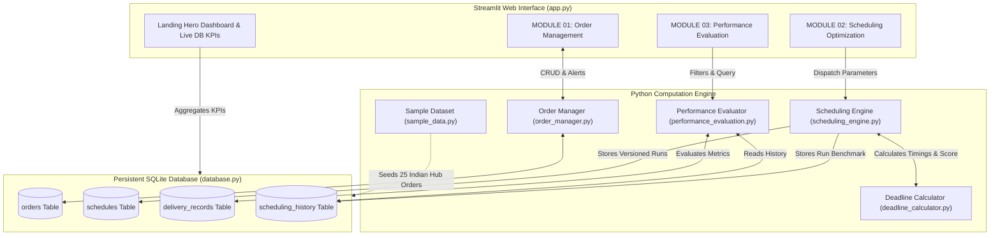
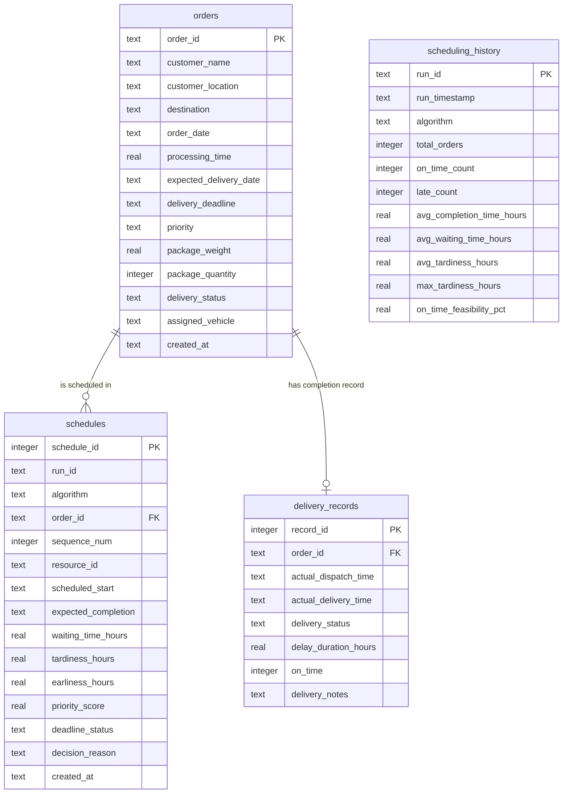

# Deadline-Aware Logistics Scheduling & Delivery Performance Evaluation

> **Official Tagline:** *Smarter Scheduling. Faster Deliveries. Measurable Performance.*

An intelligent logistics scheduling and operational analytics platform developed in Python, Streamlit, and SQLite. The platform demonstrates how Operations Research scheduling algorithms—specifically **First Come First Served (FCFS)**, **Earliest Due Date (EDD)**, and a multi-attribute **Deadline-Aware Priority Scheduling** algorithm—optimize dispatch sequences across multi-vehicle fleets, protect critical shipments from deadline violations, and evaluate delivery punctuality through rigorous key performance indicators (KPIs).

---

## 1. Project Abstract

In contemporary e-commerce and supply chain networks, logistics service providers process thousands of deadline-sensitive shipments daily. Traditional dispatch mechanisms often rely on naive first-in, first-out sequencing, ignoring heterogeneous delivery deadlines, package urgencies, and preparation durations. This project presents a complete, working academic platform that bridges operational job-shop scheduling theory and logistics execution. The application implements a deterministic time model for $N$-vehicle parallel resource dispatch, calculates multi-criteria priority scores to dynamically rank urgent orders, and evaluates delivery performance using database-backed KPIs and interactive Plotly dashboards.

---

## 2. Problem Statement

Logistics operations frequently suffer from avoidable delivery delays and service-level agreement (SLA) breaches due to:
1. **Deadline-Agnostic Sequencing:** Orders are processed in order of customer placement rather than urgency, causing tightly-deadlined parcels to queue behind long-duration, flexible-deadline jobs.
2. **Absence of Priority Weighing:** High-value or medical consignments receive the same operational attention as standard bulk freight.
3. **Unmeasured Bottlenecks:** Dispatch teams lack quantitative metrics measuring average tardiness, resource waiting times, and delivery compliance across shipment tiers.

---

## 3. Project Objectives

- **Order Management:** Register, validate, update, and monitor delivery consignments across major Indian commercial hubs with strict deadline enforcement.
- **Algorithm Implementation:** Implement deterministic scheduling engines for FCFS, EDD, and Deadline-Aware Priority algorithms across $N$ parallel delivery vehicles.
- **Academic Benchmarking:** Provide side-by-side comparative evaluations of scheduling strategies on identical order callsets without artificial bias.
- **Performance Evaluation:** Measure actual historical delivery punctuality using mathematically sound formulas with explicit denominators.
- **Interactive Visualization:** Offer Gantt timelines, punctuality donuts, status distributions, and longitudinal performance trends.

---

## 4. Existing System vs. Proposed System

| Dimension | Existing Manual / Naive System | Proposed Deadline-Aware System |
| :--- | :--- | :--- |
| **Dispatch Sequencing** | First Come First Served (FCFS) by registration time | Multi-attribute Deadline-Aware Priority & Jackson's EDD |
| **Urgency Awareness** | None; static sorting | Dynamic urgency factor relative to remaining time window |
| **Fleet Queue Allocation** | Manual vehicle assignment | Greedy parallel earliest-available resource allocation |
| **Algorithm Evaluation** | Static estimation; no benchmarking | Live 3-way comparative benchmark with tardiness tracking |
| **Performance KPIs** | Subjective or estimated | Parameterized SQL aggregations with stated denominators |
| **Audit & Versioning** | Overwrites or unversioned sheets | Versioned execution run IDs (`RUN-YYYYMMDD-...`) in SQLite |

---

## 5. Exactly Three Primary Modules

The application is architected around exactly three functional modules:

### MODULE 01 — Logistics Order Management
- **Order Registration:** Captures Order ID, Customer Name, Origin Location, Destination Hub, Order Date/Time, Preparation Time (mins), Deadline Date/Time, Shipment Priority (`Critical`, `High`, `Medium`, `Low`), Package Weight (kg), Quantity, and Delivery Status.
- **Domain Validation:** Rejects duplicate IDs, negative preparation durations, non-positive weights/quantities, and deadlines set earlier than order dates.
- **Approaching Deadline Warnings:** Surfaces prominent visual alert banners identifying orders that are overdue or due within 12 hours.
- **Search, Filter & Sort:** Multi-criteria search (ID, Customer, City), filters by priority, status, destination hub, and sorting by deadline or priority.
- **Lifecycle Actions:** Inline order updating and deletion with confirmation safeguards.

### MODULE 02 — Deadline-Aware Scheduling Optimization
- **Operational Dispatch Engine:** Simulates parallel dispatch across $N$ identical transport resources (vehicles/crews).
- **Three Scheduling Algorithms:**
  1. *First Come First Served (FCFS)*: Sequence sorted by arrival time.
  2. *Earliest Due Date (EDD)*: Sequence sorted by delivery deadline (Jackson's Rule).
  3. *Deadline-Aware Priority*: Multi-attribute composite ranking incorporating urgency, shipment priority, preparation feasibility, and route risk.
- **Gantt Timeline Visualization:** Plotly horizontal timeline charting dispatch start and completion blocks per vehicle lane.
- **Comparative Benchmark:** Side-by-side 3-way evaluation on identical candidate orders reporting on-time feasibility %, average completion time, waiting time, tardiness, and weighted tardiness.
- **Versioned Persistence:** Every run creates an immutable record in `schedules` and `scheduling_history` tables.

### MODULE 03 — Delivery Performance Evaluation
- **Formal KPI Analytics:** Evaluates delivery punctuality strictly from completed delivery records with actual timestamps (excluding active `Pending`, `Scheduled`, or `In Transit` states).
- **Six Plotly Charts:**
  1. *Delivery Punctuality Ratio* (On-Time vs. Late Donut)
  2. *Current Consignment Status Breakdown* (Bar Chart)
  3. *On-Time Delivery Rate Trend* (Line Chart over Delivery Dates)
  4. *Algorithm Feasibility Benchmark* (Bar Chart from Execution History)
  5. *Average Delay by Shipment Priority* (Bar Chart in Hours)
  6. *Daily Completed Delivery Volume* (Line Chart)
- **Factual Insights Panel:** Dynamic observations generated exclusively when verified by database records.
- **Dispatch Audit Log:** Full table listing actual dispatch and delivery times, lateness hours, and delivery notes.

---

## 6. Mathematical Formulas & Time Model

### 6.1 Dispatch Queue Time Model
For any job $i$ assigned to resource $j$ with preparation/dispatch duration $P_i$ (minutes):

$$\text{start}_i = \max(\text{resource\_free\_time}_j, \text{arrival}_i, \text{window\_start})$$

$$\text{completion}_i = \text{start}_i + P_i$$

$$\text{waiting\_time}_i = \max(0, \text{start}_i - \text{arrival}_i)$$

$$\text{tardiness}_i = \max(0, \text{completion}_i - \text{deadline}_i)$$

$$\text{earliness}_i = \max(0, \text{deadline}_i - \text{completion}_i)$$

$$\text{feasibility}_i = (\text{completion}_i \le \text{deadline}_i)$$

### 6.2 Deadline-Aware Priority Score Formulation
Each order receives a normalized composite score in $[0, 100]$:

$$\text{Priority Score} = \left( 0.40 \cdot U_i + 0.30 \cdot P_i + 0.20 \cdot F_i + 0.10 \cdot R_i \right) \times 100$$

- **Deadline Urgency ($U_i \in [0, 1]$):**
  $$U_i = \begin{cases} 1.0 & \text{if remaining time } \le 0 \text{ (overdue)} \\ 1.0 - \max\left(0, \min\left(1, \frac{\text{deadline}_i - \text{current\_time}}{\text{deadline}_i - \text{arrival}_i}\right)\right) & \text{otherwise} \end{cases}$$
- **Shipment Priority Weight ($P_i \in [0, 1]$):**
  $$\text{Critical} = 1.00, \quad \text{High} = 0.75, \quad \text{Medium} = 0.50, \quad \text{Low} = 0.25$$
- **Processing Feasibility ($F_i \in [0, 1]$):**
  $$F_i = \min\left(1.0, \frac{P_i}{\max(1.0, \text{remaining\_time}_i)}\right)$$
- **Delivery Risk ($R_i \in [0, 1]$):** Normalized factor based on destination transit tier and package weight.

### 6.3 Delivery Performance KPIs (With Stated Denominators)

1. **On-Time Delivery Rate (%):**
   $$\text{On-Time Delivery Rate} = \frac{\text{Count of Orders Delivered on or Before Deadline}}{\text{Total Completed Delivered Orders}} \times 100$$
   *Denominator:* Total orders with recorded delivery completions (`Delivered` + `Delayed`).

2. **Late Delivery Rate (%):**
   $$\text{Late Delivery Rate} = \frac{\text{Count of Late Delivered Orders}}{\text{Total Completed Delivered Orders}} \times 100$$
   *Denominator:* Total completed delivered orders.

3. **Average Delivery Delay (Hours):**
   $$\text{Average Delivery Delay} = \frac{\sum \text{Delay Duration of Late Delivered Orders}}{\text{Count of Late Delivered Orders}}$$
   *Denominator:* Count of late delivered orders only ($0.0$ if no late orders).

4. **Average Waiting Time (Hours):**
   $$\text{Average Waiting Time} = \frac{\sum \text{Waiting Time of Scheduled Orders}}{\text{Count of Completed Scheduled Orders}}$$
   *Denominator:* Scheduled jobs with waiting time records.

5. **Average Tardiness (Hours):**
   $$\text{Average Tardiness} = \frac{\sum \text{Positive Lateness Duration}}{\text{Total Completed Delivered Orders}}$$
   *Denominator:* Total completed delivered orders.

6. **Deadline Compliance (%):**
   $$\text{Deadline Compliance} = \frac{\text{Deliveries Completed Within Deadline}}{\text{Total Completed Delivered Orders}} \times 100$$
   *Denominator:* Total completed delivered orders.

---

## 7. System Architecture & Data Flow



---

## 8. Database Design (SQLite)

The database file is located at `database/logistics.db`. Foreign keys are strictly enforced (`PRAGMA foreign_keys = ON`).



---

## 9. Project Directory Structure

```text
c++ project/
│
├── app.py                      # Main Streamlit user interface & navigation
├── database.py                 # SQLite storage, schemas, parameterized queries
├── order_manager.py            # Order validation, CRUD, search, filter, alerts
├── deadline_calculator.py      # Core time arithmetic, priority score, feasibility
├── scheduling_engine.py        # FCFS, EDD, Priority algorithms, Gantt generator
├── performance_evaluation.py   # Formal KPI mathematics, insights, Plotly charts
├── sample_data.py              # 25 realistic Indian logistics consignments
├── requirements.txt            # Python dependencies (streamlit, pandas, numpy, plotly)
├── README.md                   # Complete academic documentation & Q&A
├── .env.example                # Configuration template
│
├── .streamlit/
│   ├── config.toml             # Streamlit theme & server configuration
│   └── credentials.toml        # Local credentials profile
│
├── database/
│   └── logistics.db            # Persistent SQLite database file
│
└── tests/
    ├── test_orders.py          # 8 Unit tests: Order validation, CRUD, filters
    ├── test_scheduling.py      # 9 Unit tests: Algorithms, proofs, edge cases
    └── test_performance.py     # 7 Unit tests: KPI math, safe zeros, proofs
```

---

## 10. Installation & Execution

### Prerequisites
- Python 3.10+ (Tested on Python 3.12.9)
- Standard virtual environment or pip

### Installation
```bash
pip install -r requirements.txt
```

### Running the Application
```bash
streamlit run app.py
```

*Note on systems with multiple Python installations:*
```bash
py -3.12 -m streamlit run app.py
```

Open your browser at `http://localhost:8501`.

---

## 11. Demonstration Dataset Note

The system includes 25 realistic demonstration orders spanning major Indian commercial logistics hubs:
- **Destinations:** Chennai, Bengaluru, Coimbatore, Hyderabad, Mumbai, Delhi, Pune, Kolkata, Kochi, Ahmedabad.
- **Consignors:** Apollo Hospitals Pharmacy, Tata Croma Electronics, Reliance Retail, Sun Pharma, Serum Institute, Bosch Automotive, Mahindra Aerospace, Flipkart Fulfillment, etc.
- **Mix of States:**
  - 6 Delivered on-time orders
  - 3 Delivered delayed orders (historical delay analysis)
  - 2 In Transit consignments
  - 1 Scheduled consignment
  - 13 Active Pending consignments ready for scheduling optimization
- **Idempotency:** Clicking "Load Demo Data" seeds the records safely without duplication.

---

## 12. Testing & Verification

The project includes 24 automated unit tests covering all mathematical formulas, scheduling rules, and edge cases.

### Running Tests
```bash
python -m unittest discover -s tests
```

### Verified Test Results
```text
Ran 24 tests in 0.465s

OK
```
- **`tests/test_orders.py` (8 Tests):** Duplicate ID rejection, past deadline rejection, negative processing time rejection, negative weight/quantity rejection, valid order registration, search/filter queries, inline updates, and cascading deletion.
- **`tests/test_scheduling.py` (9 Tests):** Empty input safety, zero/negative vehicle validation, exclusion of delivered/cancelled orders, identical deadline tie-breaking, past deadline handling without division by zero, midnight crossing, numerical proofs for FCFS and EDD (Jackson's Rule), and versioned persistence.
- **`tests/test_performance.py` (7 Tests):** Safe zero handling on empty data, 100% on-time scenario, 100% late scenario, mixed delivery scenario, exclusion of non-delivered active orders, exclusion of cancelled orders, and hand-calculated KPI verification.

---

## 13. System Limitations & Future Enhancements

### Limitations
1. **Deterministic Travel Durations:** Processing and transit times are modeled deterministically based on operational preparation and standard transit estimates.
2. **Homogeneous Resources:** Delivery vehicles in a given run are modeled as identical parallel processing resources without dynamic volume constraints.
3. **Static Traffic Conditions:** Does not ingest live GPS traffic feeds en route.

### Future Enhancements
1. **Dynamic Routing Integration:** Integrate OpenStreetMap / OSRM API for turn-by-turn live traffic routing.
2. **Vehicle Routing Problem with Time Windows (VRPTW):** Combine job sequencing with multi-stop 2D geospatial routing.
3. **Stochastic Duration Modeling:** Monte Carlo simulation for weather and highway checkpoint variability.

---

## 14. Academic Mentor & Faculty Q&A Guide

Below are concise, technically sound answers to common faculty examination questions:

#### Q1: What problem does this project solve?
**Answer:** It addresses the logistics challenge of deadline violations. Traditional dispatching uses FIFO/FCFS, which ignores when shipments are due. This system models logistics dispatch as a parallel-machine scheduling problem that sequences jobs by urgency, priority, and processing feasibility to minimize tardiness.

#### Q2: What is deadline-aware logistics scheduling?
**Answer:** It is an operations research methodology where dispatch decisions are explicitly governed by delivery deadlines rather than order placement times. Jobs with imminent deadlines and tight preparation windows are prioritized ahead of older but more flexible orders.

#### Q3: Why is scheduling important in logistics?
**Answer:** Fleet and warehouse staging resources are finite. Proper scheduling reduces waiting times, prevents downstream delivery delays, maximizes vehicle utilization, and ensures strict adherence to customer service level agreements (SLAs).

#### Q4: What is FCFS?
**Answer:** First Come First Served (FCFS) sequences orders strictly by arrival or registration timestamp. While straightforward and perceptionally fair to customers, it is deadline-blind and frequently causes high maximum tardiness when long jobs arrive first.

#### Q5: What is EDD?
**Answer:** Earliest Due Date (EDD) orders jobs by their delivery deadline (earliest deadline first). Proven by Jackson's Rule (1955), EDD mathematically minimizes the maximum tardiness ($L_{\max}$) across all jobs on a single machine or resource.

#### Q6: What is priority-based scheduling?
**Answer:** Priority-based scheduling ranks jobs based on a composite urgency score combining customer priority (e.g., medical supplies vs. non-perishable goods), remaining time before deadline, preparation duration, and delivery risk.

#### Q7: How is the priority score calculated?
**Answer:**
$$\text{Score} = 0.40 \cdot \text{Urgency} + 0.30 \cdot \text{Priority} + 0.20 \cdot \text{Feasibility} + 0.10 \cdot \text{Risk}$$
All factors are normalized to $[0, 1]$. Overdue orders receive maximum urgency ($1.0$). Feasibility measures the ratio of processing time to remaining window, capturing schedule tightness.

#### Q8: How does the system identify delayed orders?
**Answer:** For scheduled orders, it checks if $\text{Expected Completion} > \text{Deadline}$. For completed deliveries, it compares $\text{Actual Delivery Time} > \text{Deadline}$ in the database and records the difference as positive delay hours.

#### Q9: What is tardiness vs. earliness?
**Answer:** 
- $\text{Tardiness} = \max(0, \text{Completion} - \text{Deadline})$: Measures lateness when an order finishes after its deadline.
- $\text{Earliness} = \max(0, \text{Deadline} - \text{Completion})$: Measures buffer slack when an order finishes before its deadline.

#### Q10: How is the On-Time Delivery Rate calculated?
**Answer:**
$$\text{On-Time Delivery Rate} = \frac{\text{On-Time Deliveries}}{\text{Total Completed Deliveries}} \times 100$$
Crucially, the denominator includes only evaluated completed deliveries (`Delivered` + `Delayed`). Pending, Scheduled, and In Transit shipments are active states and are not counted as delivered.

#### Q11: How are scheduling algorithms compared?
**Answer:** FCFS, EDD, and Deadline-Aware Priority are executed against the exact same candidate dataset and fleet size. Metrics compared include: on-time feasibility %, predicted late count, average completion time, average waiting time, average tardiness, maximum tardiness, and total weighted tardiness.

#### Q12: Why did I choose Python and Streamlit?
**Answer:** Python offers powerful data structures, datetime manipulation, and standard libraries for implementing operations research algorithms. Streamlit allows building a responsive, reactive web interface with state management and embedded Plotly dashboards using pure Python.

#### Q13: Why is SQLite used?
**Answer:** SQLite is a serverless, self-contained, transactional relational database that enforces ACID properties, foreign key constraints, and parameterized SQL queries without external infrastructure overhead, ensuring persistent data across application restarts.

#### Q14: What are the limitations of the proposed system?
**Answer:** The current system models dispatch and travel times deterministically and assumes fleet resources are homogeneous. In production, stochastic travel times caused by weather, road works, and vehicle breakdowns would require continuous re-optimization and telematics integration.
